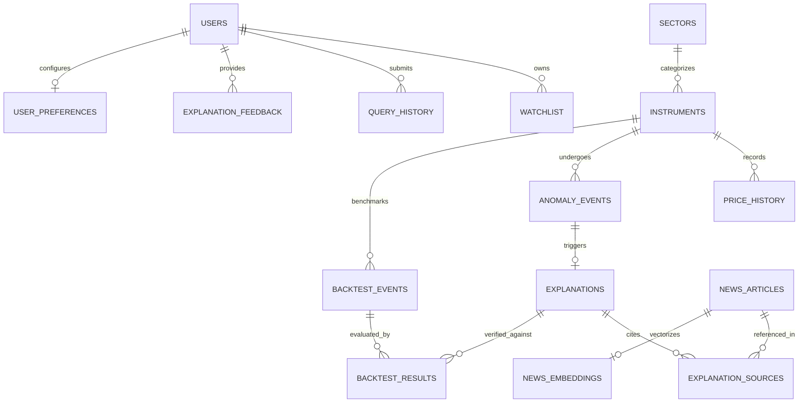

# MarketMind — Complete Project Schema Specification

This document provides the complete, authoritative reference for all data schemas across the **MarketMind** project:
1. **Relational Database Schemas** (App Schema & ML Engine Schema with pgvector)
2. **Entity-Relationship (ER) Architecture**
3. **Database Enumerations & Domain Constraints**
4. **Machine Learning Feature & Vector Schemas**
5. **Backend DTOs & Microservice API Schemas** (Spring Boot & FastAPI)
6. **Dataset & Storage Schemas** (CSV Corpus & JSON Fixtures)
7. **Frontend TypeScript Data Models**

---

## 1. System Architecture & Entity-Relationship Diagram



---

## 2. Relational Database Schemas (PostgreSQL + pgvector)

MarketMind employs a dual Flyway migration architecture separating user application concerns from the high-performance quantitative/ML engine.

### 2.1 Core Domain ENUMs (`db/migration/engine/V1__init_schema.sql`)

| Enum Name | Allowed Values | Description |
| :--- | :--- | :--- |
| `instrument_type` | `'stock'`, `'fund'`, `'index'` | Type of financial asset |
| `market_cap_category` | `'large'`, `'mid'`, `'small'` | Market capitalization classification |
| `regime_label` | `'bullish'`, `'bearish'`, `'consolidating'` | Price momentum state |
| `sentiment_label` | `'bullish'`, `'bearish'`, `'neutral'` | FinBERT classified tone |
| `causal_category` | `'earnings'`, `'regulatory'`, `'geopolitical'`, `'macro'`, `'sector_specific'`, `'company_specific'`, `'market_flows'`, `'unclear'` | Driver classification |
| `confidence_label` | `'high'`, `'medium'`, `'low'` | Confidence tier of explanation |
| `signal_agreement_label`| `'aligned'`, `'diverging'`, `'insufficient'` | Convergence state between price and news |

---

### 2.2 Application Database Schema (`db/migration/app/V1__app_tables.sql`)

Manages client users, session state, personal watchlists, query audit trails, and human-in-the-loop feedback.

#### `users`
Primary user identity and credentials table.
```sql
CREATE TABLE users (
    id            UUID PRIMARY KEY DEFAULT uuid_generate_v4(),
    email         VARCHAR(255) NOT NULL UNIQUE,
    password_hash VARCHAR(255) NOT NULL,
    full_name     VARCHAR(255),
    created_at    TIMESTAMPTZ NOT NULL DEFAULT now()
);
```

#### `watchlist`
User-monitored tickers with unique constraint per user.
```sql
CREATE TABLE watchlist (
    id         BIGSERIAL PRIMARY KEY,
    user_id    UUID NOT NULL REFERENCES users(id) ON DELETE CASCADE,
    symbol     VARCHAR(50) NOT NULL,
    created_at TIMESTAMPTZ NOT NULL DEFAULT now(),
    CONSTRAINT uq_watchlist_user_symbol UNIQUE (user_id, symbol)
);
CREATE INDEX idx_watchlist_user ON watchlist(user_id);
```

#### `query_history`
Natural language search logs with extracted intent and resolved stock symbols.
```sql
CREATE TABLE query_history (
    id               BIGSERIAL PRIMARY KEY,
    user_id          UUID NOT NULL REFERENCES users(id) ON DELETE CASCADE,
    raw_query        TEXT NOT NULL,
    intent           VARCHAR(50) NOT NULL,
    resolved_symbols TEXT[] NOT NULL DEFAULT '{}',
    created_at       TIMESTAMPTZ NOT NULL DEFAULT now()
);
CREATE INDEX idx_query_history_user ON query_history(user_id, created_at DESC);
```

#### `explanation_feedback`
User validation and quality scoring for causal explanations.
```sql
CREATE TABLE explanation_feedback (
    id           BIGSERIAL PRIMARY KEY,
    user_id      UUID NOT NULL REFERENCES users(id) ON DELETE CASCADE,
    symbol       VARCHAR(50) NOT NULL,
    anomaly_date DATE NOT NULL,
    helpful      BOOLEAN NOT NULL,
    comment      TEXT,
    created_at   TIMESTAMPTZ NOT NULL DEFAULT now(),
    CONSTRAINT uq_feedback_user_symbol_date UNIQUE (user_id, symbol, anomaly_date)
);
CREATE INDEX idx_feedback_user_symbol ON explanation_feedback(user_id, symbol);
```

#### `user_preferences`
Personalization settings and UI configurations.
```sql
CREATE TABLE user_preferences (
    id                    BIGSERIAL PRIMARY KEY,
    user_id               UUID NOT NULL UNIQUE REFERENCES users(id) ON DELETE CASCADE,
    default_lookback_days INT NOT NULL DEFAULT 60,
    reduced_motion        BOOLEAN NOT NULL DEFAULT false,
    updated_at            TIMESTAMPTZ NOT NULL DEFAULT now()
);
```

---

### 2.3 ML Engine & Quantitative Schema (`db/migration/engine/V1__init_schema.sql`)

Stores OHLCV bars, embeddings, detected anomalies, citations, and causal generation results.

#### `sectors`
Industry definitions and inter-sector supply chain dependencies.
```sql
CREATE TABLE sectors (
    id               SERIAL PRIMARY KEY,
    name             VARCHAR(100) UNIQUE NOT NULL,
    key_dependencies JSONB,
    created_at       TIMESTAMPTZ NOT NULL DEFAULT now()
);
```

#### `instruments`
Master table of tracked equities and indices.
```sql
CREATE TABLE instruments (
    id                  SERIAL PRIMARY KEY,
    symbol              VARCHAR(20) UNIQUE NOT NULL,
    name                VARCHAR(255) NOT NULL,
    type                instrument_type NOT NULL DEFAULT 'stock',
    sector_id           INTEGER REFERENCES sectors(id),
    market_cap_category market_cap_category,
    is_active           BOOLEAN NOT NULL DEFAULT true,
    created_at          TIMESTAMPTZ NOT NULL DEFAULT now()
);
CREATE INDEX idx_instruments_sector ON instruments(sector_id);
```

#### `price_history`
Daily OHLCV series for individual instruments.
```sql
CREATE TABLE price_history (
    id            BIGSERIAL PRIMARY KEY,
    instrument_id INTEGER NOT NULL REFERENCES instruments(id),
    date          DATE NOT NULL,
    open          NUMERIC(12,2) NOT NULL,
    high          NUMERIC(12,2) NOT NULL,
    low           NUMERIC(12,2) NOT NULL,
    close         NUMERIC(12,2) NOT NULL,
    volume        BIGINT NOT NULL,
    UNIQUE (instrument_id, date)
);
CREATE INDEX idx_price_history_instrument_date ON price_history(instrument_id, date DESC);
```

#### `index_history`
Benchmark index close prices (e.g., Nifty 50, Nifty Bank).
```sql
CREATE TABLE index_history (
    id           BIGSERIAL PRIMARY KEY,
    index_symbol VARCHAR(50) NOT NULL,
    date         DATE NOT NULL,
    close        NUMERIC(12,2) NOT NULL,
    UNIQUE (index_symbol, date)
);
CREATE INDEX idx_index_history_symbol_date ON index_history(index_symbol, date DESC);
```

#### `news_articles`
Ingested news corpus with extracted entities and FinBERT annotations.
```sql
CREATE TABLE news_articles (
    id              BIGSERIAL PRIMARY KEY,
    source          VARCHAR(100) NOT NULL,
    url             TEXT UNIQUE NOT NULL,
    title           TEXT NOT NULL,
    raw_text        TEXT,
    published_at    TIMESTAMPTZ NOT NULL,
    entities        TEXT[],
    sector_tags     TEXT[],
    sentiment_label sentiment_label,
    sentiment_score NUMERIC(4,3),
    causal_category causal_category,
    ingested_at     TIMESTAMPTZ NOT NULL DEFAULT now()
);
CREATE INDEX idx_news_published_at ON news_articles(published_at);
CREATE INDEX idx_news_entities ON news_articles USING GIN(entities);
CREATE INDEX idx_news_sector_tags ON news_articles USING GIN(sector_tags);
```

#### `news_embeddings`
Dense vector embeddings stored with `pgvector` for semantic search.
```sql
CREATE TABLE news_embeddings (
    id          BIGSERIAL PRIMARY KEY,
    article_id  BIGINT UNIQUE NOT NULL REFERENCES news_articles(id),
    embedding   VECTOR(768) NOT NULL,
    model_name  VARCHAR(100) NOT NULL DEFAULT 'bge-base-en-v1.5',
    created_at  TIMESTAMPTZ NOT NULL DEFAULT now()
);
CREATE INDEX idx_news_embeddings_vector ON news_embeddings
    USING ivfflat (embedding vector_cosine_ops) WITH (lists = 100);
```

#### `anomaly_events`
Outlier price moves detected by statistical z-score and XGBoost classifiers.
```sql
CREATE TABLE anomaly_events (
    id                BIGSERIAL PRIMARY KEY,
    instrument_id     INTEGER NOT NULL REFERENCES instruments(id),
    start_date        DATE NOT NULL,
    end_date          DATE NOT NULL,
    return_z_score    NUMERIC(6,3) NOT NULL,
    volume_z_score    NUMERIC(6,3),
    excess_return     NUMERIC(6,3),
    regime_label      regime_label,
    regime_confidence NUMERIC(4,3),
    created_at        TIMESTAMPTZ NOT NULL DEFAULT now()
);
CREATE INDEX idx_anomaly_instrument_dates ON anomaly_events(instrument_id, start_date DESC);
```

#### `explanations`
Synthesized causal narratives (200–250 words or explicit abstention).
```sql
CREATE TABLE explanations (
    id                  BIGSERIAL PRIMARY KEY,
    anomaly_event_id    BIGINT UNIQUE NOT NULL REFERENCES anomaly_events(id),
    generated_text      TEXT NOT NULL,
    confidence_label    confidence_label NOT NULL,
    signal_agreement    signal_agreement_label NOT NULL,
    aggregate_sentiment sentiment_label,
    generated_at        TIMESTAMPTZ NOT NULL DEFAULT now()
);
```

#### `explanation_sources`
Join table linking causal explanations to cited news articles with ordered citation tags (`[1]`, `[2]`).
```sql
CREATE TABLE explanation_sources (
    id             BIGSERIAL PRIMARY KEY,
    explanation_id BIGINT NOT NULL REFERENCES explanations(id) ON DELETE CASCADE,
    article_id     BIGINT NOT NULL REFERENCES news_articles(id),
    footnote_rank  SMALLINT NOT NULL,
    UNIQUE (explanation_id, footnote_rank)
);
```

#### `backtest_events` & `backtest_results`
Ground-truth benchmark suite for continuous evaluation and hallucination monitoring.
```sql
CREATE TABLE backtest_events (
    id                  SERIAL PRIMARY KEY,
    instrument_id       INTEGER NOT NULL REFERENCES instruments(id),
    event_date          DATE NOT NULL,
    known_cause_summary TEXT NOT NULL,
    source_reference    TEXT,
    category            causal_category,
    created_at          TIMESTAMPTZ NOT NULL DEFAULT now()
);

CREATE TABLE backtest_results (
    id                 SERIAL PRIMARY KEY,
    backtest_event_id  INTEGER NOT NULL REFERENCES backtest_events(id),
    explanation_id     BIGINT REFERENCES explanations(id),
    relevance_score    SMALLINT,
    correctness_score  SMALLINT,
    groundedness_score SMALLINT,
    rated_by           VARCHAR(100),
    rated_at           TIMESTAMPTZ NOT NULL DEFAULT now()
);
```

---

## 3. Machine Learning & Quantitative Data Schemas

### 3.1 XGBoost Technical Indicator Feature Vector
Calculated over a rolling 20-to-60 trading day window (`ml_service/models/price_classifier.py`):

| Feature | Mathematical Definition | Purpose |
| :--- | :--- | :--- |
| `return` | $\frac{C_t - C_{t-1}}{C_{t-1}}$ | Instantaneous daily price change |
| `sma_20` | $\frac{1}{20} \sum_{i=0}^{19} C_{t-i}$ | Short-term trend baseline |
| `sma_50` | $\frac{1}{50} \sum_{i=0}^{49} C_{t-i}$ | Medium-term trend baseline |
| `return_zscore` | $\frac{R_t - \mu_{R, 20}}{\sigma_{R, 20}}$ | Outlier magnitude for price returns |
| `volume_zscore` | $\frac{V_t - \mu_{V, 20}}{\sigma_{V, 20}}$ | Institutional volume shock indicator |
| `rsi_14` | $100 - \frac{100}{1 + RS_{14}}$ | Momentum overbought/oversold indicator |
| `macd` | $\text{EMA}_{12}(C) - \text{EMA}_{26}(C)$ | Trend divergence metric |
| `macd_signal` | $\text{EMA}_{9}(\text{MACD})$ | Trigger line for MACD crossovers |

### 3.2 FinBERT Sentiment & Causal Output Schema
Generated per article and aggregated over the observation window:
* **Sentiment Probabilities**: $P(\text{positive}) + P(\text{negative}) + P(\text{neutral}) = 1.0$
* **Weighted Aggregate Sentiment**:
  $$\text{Score} = \frac{\sum_{k=1}^N w_k \cdot (P(\text{positive})_k - P(\text{negative})_k)}{\sum_{k=1}^N w_k} \in [-1.0, +1.0]$$
  * Weights $w_k$: `company_direct` (1.0), `sector_industry` (0.6), `macro_market` (0.4), `weak` (0.15).
* **Causal Category**: Enum of `earnings`, `regulatory`, `geopolitical`, `macroeconomic`, `sector-specific`, `company-specific`.

---

## 4. Backend DTOs & Microservice API Schemas

### 4.1 Python FastAPI Schemas (`ml_service/api/schemas.py`)

#### `OHLCVRecord` & `PriceRegimeRequest`
```python
class OHLCVRecord(BaseModel):
    date: str
    open: float
    high: float
    low: float
    close: float
    volume: float

class PriceRegimeRequest(BaseModel):
    symbol: str
    ohlcv_records: List[OHLCVRecord]
```

#### `CitationItem`
```python
class CitationItem(BaseModel):
    id: Optional[str] = None
    news_id: Optional[str] = None
    title: str
    source: str
    published_at: str
    relevance_score: Optional[float] = 0.5
    link: Optional[str] = None
    sentiment: Optional[str] = None
    confidence: Optional[float] = None
    snippet: str
```

#### `RAGSynthesisRequest` & `RAGSynthesisResponse`
```python
class RAGSynthesisRequest(BaseModel):
    symbol: str
    movement_date: str
    price_regime: Optional[str] = "bullish"
    price_confidence: Optional[float] = 0.85
    query_context: Optional[str] = ""

class RAGSynthesisResponse(BaseModel):
    symbol: str
    movement_date: str
    price_regime: str
    abstain: bool
    explanation: str
    confidence_score: float
    primary_causal_category: str
    citations: List[CitationItem]
    evidence_count: int
```

#### Natural Language Analysis Models (`QueryUnderstandResponse`, `QueryAnalysisResponse`)
```python
class QueryUnderstandResponse(BaseModel):
    original_query: str
    company_name: Optional[str] = None
    ticker: Optional[str] = None
    market: Optional[str] = None
    exchange: Optional[str] = None
    date_expression: Optional[str] = None
    start_date: Optional[str] = None
    end_date: Optional[str] = None
    time_expression_confidence: float = 0.0
    search_keywords: List[str] = []
    topic: List[str] = []
    intent: str
    requires_clarification: bool
    clarification_reason: Optional[str] = None
    clarification_type: Optional[str] = None
    clarification_options: Optional[List[Dict[str, Any]]] = None
    stock_candidates: Optional[List[Dict[str, Any]]] = None
```

---

### 4.2 Spring Boot DTO Contracts (`backend/src/main/java/com/marketmind/engine/dto/`)

#### `ExplanationDto.java`
The primary payload served to the Research Desk:
```java
public record ExplanationDto(
    String symbol,
    LocalDate date,
    String priceDirection,
    BigDecimal returnPct,
    BigDecimal returnZ,
    boolean hasClearDriver,
    String causeSummary,
    String causalCategory,
    String scope,
    String newsDirection,
    String signalAgreement,
    String confidence,
    List<CitationDto> citations
) {}
```

#### `CitationDto.java`
```java
public record CitationDto(
    int n,
    String title,
    String source,
    String url,
    String publishedDate
) {}
```

#### `AnomalyDto.java`
```java
public record AnomalyDto(
    String symbol,
    LocalDate date,
    String direction,
    BigDecimal returnPct,
    BigDecimal returnZ,
    String label,
    String confidence
) {}
```

#### `MarketPulseDto.java`
```java
public record MarketPulseDto(
    int bullishCount,
    int bearishCount,
    int neutralCount,
    String dialLabel,
    BigDecimal dialScore,
    HorizonDto shortTerm,
    HorizonDto mediumTerm,
    HorizonDto longTerm
) {}
```

---

## 5. File & Dataset Schemas

### 5.1 Historical News Dataset (`india_stock_news_2025.csv`)
Contains 5,579 verified financial articles:

| Field | Type | Description | Example |
| :--- | :--- | :--- | :--- |
| `news_id` | String | Unique hash or identifier | `"62d308c2317abbd5"` |
| `timestamp` | String (YYYY-MM-DD HH:MM:SS) | IST Normalized publication time | `"2025-01-03 08:00:00"` |
| `title` | String | Headline of article | `"State Bank of India unveils two new schemes..."` |
| `text_content` | String | Extracted body text | `"State Bank of India – the country’s largest..."` |
| `link` | String (URL) | Canonical publisher / decoded link | `"https://news.google.com/rss/articles/..."` |
| `stock` | String (Ticker) | Associated stock ticker | `"SBIN"` |
| `market_label`| String (Nullable) | Initial market direction label | `"bullish"`, `NaN` |
| `confidence` | Float (Nullable) | Label confidence score | `0.85`, `NaN` |

### 5.2 Sample News Corpus (`ml_service/data/sample_news.json`)
Structured JSON fixture used for quick deterministic testing and RAG benchmarks:
```json
{
  "id": "news-001",
  "symbol": "TATASTEEL",
  "published_at": "2026-08-02T18:30:00Z",
  "title": "Tata Steel Reports Strong Q1 Earnings Beats Analyst Estimates",
  "content": "Tata Steel announced a 35% year-on-year increase in net profit...",
  "source": "Financial Express",
  "sentiment": "bullish",
  "causal_category": "earnings"
}
```

---

## 6. Frontend TypeScript Interfaces (`frontend/src/types/index.ts`)

```typescript
export interface Instrument {
  symbol: string;
  name: string;
  type: string;
  sector: string;
}

export interface PricePoint {
  date: string;
  open: number;
  high: number;
  low: number;
  close: number;
  volume: number;
}

export interface Anomaly {
  symbol: string;
  date: string;
  direction: 'bullish' | 'bearish';
  returnPct: number;
  returnZ: number;
  label: string;
  confidence: string;
}

export interface Citation {
  n: number;
  title: string;
  source: string;
  url: string;
  publishedDate: string;
}

export interface Explanation {
  symbol: string;
  date: string;
  priceDirection: 'bullish' | 'bearish' | 'neutral' | 'consolidating';
  returnPct: number;
  returnZ: number;
  hasClearDriver: boolean;
  causeSummary: string;
  causalCategory: string;
  scope: string;
  newsDirection: 'bullish' | 'bearish' | 'neutral' | 'no_news_available' | 'retrieval_failed';
  signalAgreement: 'aligned' | 'diverging' | 'insufficient';
  confidence: 'high' | 'medium' | 'low';
  citations: Citation[];
  sentimentScore?: number | null;
  validationStatus?: 'VALID' | 'PARTIALLY_VALID' | 'INVALID' | 'INSUFFICIENT_EVIDENCE';
  validationErrors?: string[];
  validatedCitations?: number[];
  divergenceAnalysis?: string;
  retrievalStatus?: string;
  priceDataAvailable?: boolean;
}

export interface MarketPulse {
  bullishCount: number;
  bearishCount: number;
  neutralCount: number;
  dialLabel: string;
  dialScore: number;
  shortTerm: Horizon;
  mediumTerm: Horizon;
  longTerm: Horizon;
}

export interface SectorSnapshot {
  sector: string;
  sentiment: string;
  changePct: number;
  topSymbols: string[];
}

export interface User {
  id: string;
  email: string;
  fullName: string;
  createdAt: string;
}
```

