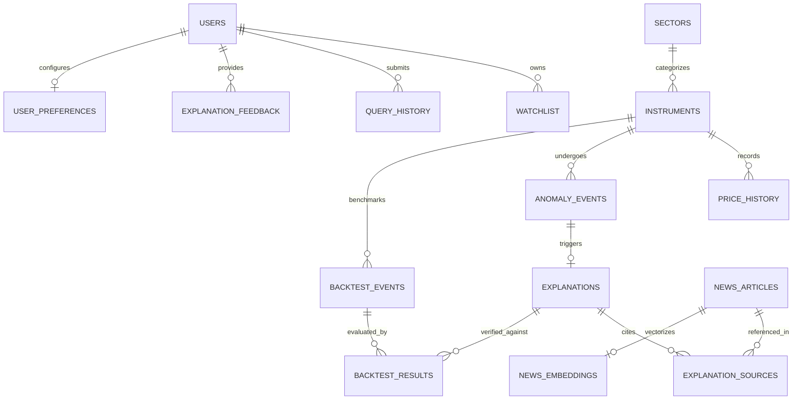

# MarketMind: Master Project Specification & Comprehensive System Dossier

> **File:** `project.md`  
> **Status:** Authoritative Master Reference Document  
> **System Name:** MarketMind — Financial Intelligence & Causal Explanation System  
> **Repository:** `Mega-Project_Illuminati-2026-27`  

---

## 1. Project Metadata & Academic Profile

* **Project Title**: MarketMind — Explainable AI Stock Movement & Causal Reasoning System
* **Institution**: Walchand College of Engineering, Sangli (Department of Computer Science & Engineering)
* **Academic Year**: 2026–2027
* **Project Guide**: Ms. Aditi A. Pawde
* **Team Members & Leadership Roles**:
  * **Alok Avinash Kulkarni** (PRN: 22510013) — Backend Architecture, Database Design & API Gateway Lead
  * **Piyush Vilas Rajurkar** (PRN: 23510087) — ML Pipeline, FinBERT Sentiment & Time-Constrained RAG Causal Engine Lead
  * **Piyush Vikas Dawkhare** (PRN: 23510056) — Data Engineering, Web Scrapers & Ingestion Infrastructure
  * **Niharika Santoshkumar Pasnur** (PRN: 23510119) — Frontend Research Desk Engineering & "Ledger Dossier" UI/UX

---

## 2. Executive Summary & Problem Statement

### 2.1 The Fundamental Flaws of Modern Financial Terminals
Retail investors, equity analysts, and institutional desks constantly monitor sudden market swings. Popular financial platforms (Bloomberg Terminal, TradingView, Moneycontrol, Google Finance) suffer from three critical deficiencies:

1. **Correlation vs. Causation Fallacy**:
   When a stock plunges 4% and a news article appears on the same day, traditional platforms juxtapose the two feeds side-by-side, misleading users into inferring causality. They fail to verify whether the news was published *prior* to or *after* the intraday shock, whether the news sentiment was genuinely relevant, or if the movement was systemic sector rotation.
2. **Look-Ahead Bias (Data Leakage) in Generative AI**:
   Generic Large Language Models (LLMs) like ChatGPT or standard RAG pipelines suffer from hindsight bias. When querying why an asset moved on a historical date (e.g., March 15, 2025), general LLMs frequently cite earnings calls, regulatory announcements, or macroeconomic revisions that occurred *days or weeks later*, invalidating historical analysis and backtesting.
3. **Compulsive Hallucination & Lack of Honest Abstention**:
   Conventional generative systems feel compelled to supply an explanation for every single price candle. In reality, quantitative empirical finance reveals that over 35–45% of intraday moves are driven by noise, structural rebalancing, liquidity shocks, or automated algorithmic trades where **no verifiable news driver exists**.

### 2.2 The MarketMind Solution
MarketMind is a deterministic, explainable financial intelligence platform that unifies:
* **Quantitative Price Regime Classification**: Rolling return z-scores, volume spikes, and XGBoost pattern classification derived from official NSE/BSE OHLCV historical records.
* **Qualitative Financial Sentiment Inference**: Multi-task Transformer FinBERT (`ProsusAI/finbert`) classifying sentiment polarity (`bullish`, `bearish`, `conflicting`, `neutral`) and 6 causal categories.
* **Formal Signal Agreement Matrix**: Validates whether price momentum and news tone are **Aligned**, **Diverging**, or **Ambiguous**.
* **Strict Time-Constrained RAG**: Dense vector semantic retrieval enforcing hard non-leakage ($t_{\text{published}} \le t_{\text{movement}}$) with IST/NSE market-session alignment.
* **Calibrated Causal Synthesis**: A controlled Google Gemini LLM pipeline generating concise, institutional-grade causal narratives (200–250 words when evidence is sufficient; concise when sparse) with bracketed footnote citations (`[1]`, `[2]`).
* **Claim-Level Fact Validation Layer**: Decomposes explanations into factual statements to verify empirical grounding against retrieved text, flagging unsupported assertions.
* **First-Class Honest Abstention**: Refuses to hallucinate explanations when news coverage is missing, returning a structured unconfirmed/abstention state.

---

## 3. System Architecture & High-Level Topology

MarketMind operates as a decoupled, multi-tier distributed architecture spanning three core services:

```
┌────────────────────────────────────────────────────────────────────────┐
│             TIER 1: CLIENT FRONTEND (React 18 + Vite + TS)             │
│        Research Desk Dossier  |  Market Pulse  |  Financial Tools      │
│                     URL: http://localhost:5173                         │
└───────────────────▲────────────────────────────────▲───────────────────┘
                    │                                │
          REST / JSON (Port 8085)          Direct ML Query (Port 8000)
                    │                                │
┌───────────────────▼────────────────────────────────┴───────────────────┐
│         TIER 2: BACKEND API GATEWAY (Spring Boot 3.3.4, Java 21)       │
│  - JWT Security & User Auth         - Caffeine Dual-Tier Cache (10s)   │
│  - PostgreSQL / H2 Dual Migrations  - Pluggable InsightEngine Abstr.   │
│                     URL: http://localhost:8085                         │
│               Swagger: http://localhost:8085/swagger-ui.html           │
└────────────────────────────────────▲───────────────────────────────────┘
                                     │
                        Internal REST (Port 8000)
                                     │
┌────────────────────────────────────▼───────────────────────────────────┐
│        TIER 3: ML & RAG CAUSAL MICROSERVICE (FastAPI, Python 3.11)     │
│  - Quantitative XGBoost Classifier  - FinBERT Sentiment & Causal Model │
│  - Signal Agreement Engine         - Time-Constrained RAG Engine       │
│  - Multi-Provider News Pipeline    - Calibrated Gemini Explainer       │
│  - Claim-Level Validator           - Terminal CLI Dashboard            │
│                     URL: http://127.0.0.1:8000                         │
│                 Interactive Docs: http://127.0.0.1:8000/docs           │
└────────────────────────────────────────────────────────────────────────┘
```

### Port Mapping & Access Table

| Service | Technology Stack | Port | Access URL | Primary Responsibilities |
| :--- | :--- | :---: | :--- | :--- |
| **Frontend UI** | React 18, Vite, TypeScript, Tailwind | `5173` | `http://localhost:5173` | Research desk, interactive charts, pulse meter, calculators, interactive tour |
| **Backend Gateway** | Java 21, Spring Boot 3.3.4, Flyway | `8085` | `http://localhost:8085` | User authentication, watchlists, query resolution, audit history, caching |
| **ML Microservice** | Python 3.11, FastAPI, Uvicorn | `8000` | `http://127.0.0.1:8000` | Quantitative models, FinBERT inference, RAG retrieval, Gemini synthesis |
| **Database** | PostgreSQL 16 + pgvector / H2 | `5432` | `localhost:5432` / Supabase | Relational data, user records, vectors, news articles, historical prices |

---

## 4. Module 1: Python ML & RAG Microservice (`ml_service/`)

**Lead**: Piyush Vilas Rajurkar  
**Path**: `/ml_service/`

The ML microservice is an institutional-grade quantitative and NLP intelligence engine built on FastAPI.

### 4.1 Quantitative Price Regime Classifier (`ml_service/models/price_classifier.py`)
Analyzes raw daily OHLCV candlestick records from the National Stock Exchange of India (NSE).
* **Mathematical Formulations**:
  $$\text{Daily Return: } R_t = \frac{C_t - C_{t-1}}{C_{t-1}}$$
  $$\text{Rolling Mean: } \mu_{60} = \frac{1}{60} \sum_{i=0}^{59} R_{t-i}, \quad \text{Rolling Std: } \sigma_{60} = \sqrt{\frac{1}{60} \sum_{i=0}^{59} (R_{t-i} - \mu_{60})^2}$$
  $$\text{Return Z-Score: } Z_t = \frac{R_t - \mu_{60}}{\sigma_{60}}$$
  $$\text{Volume Z-Score: } Z_{v, t} = \frac{V_t - \mu_{V, 20}}{\sigma_{V, 20}}$$
* **Regime Categorization**:
  * **Bullish**: $Z_t \ge +1.50$ (or breakout above upper Bollinger band).
  * **Bearish**: $Z_t \le -1.50$ (or breakdown below lower Bollinger band).
  * **Consolidating**: $-1.50 < Z_t < +1.50$.
* **XGBoost Feature Vector**:
  `[return, sma_20, sma_50, return_zscore, volume_zscore, rsi_14, macd, macd_signal]`.
* **Hardware Acceleration**: Automatic fallback between CUDA GPU acceleration (`tree_method='hist'`, `device='cuda'`) and CPU execution.

### 4.2 FinBERT Sentiment & Causal Domain Classifier (`ml_service/models/sentiment_causal_classifier.py`)
* **Underlying Model**: `ProsusAI/finbert` (Hugging Face Transformers / PyTorch), specialized for financial vocabulary.
* **Multi-Task Inference**:
  1. **Editorial Sentiment**: Computes Softmax probabilities across `positive`, `negative`, and `neutral`.
  2. **Causal Categorization**: Assigns text to one of 6 fundamental market drivers:
     - `earnings`: Quarterly results, revenue/EBITDA margins, guidance adjustments.
     - `regulatory`: RBI interest rate changes, SEBI compliance notices, import/export duties.
     - `geopolitical`: Crude oil disruptions, international trade treaties, conflicts.
     - `macroeconomic`: CPI/WPI inflation data, GDP growth figures, sovereign bond yields.
     - `sector-specific`: Raw material price shifts, sector subsidies, tariff changes.
     - `company-specific`: Executive management changes, contract wins, mergers/acquisitions.
* **Relevance-Weighted Corpus Aggregation**:
  $$\text{Weighted Sentiment Score} = \frac{\sum_{k=1}^N w_k \cdot \Big( P(\text{pos})_k - P(\text{neg})_k \Big)}{\sum_{k=1}^N w_k} \in [-1.0, +1.0]$$
  * Weights: Direct company focus ($w=1.0$), Sector/industry ($w=0.6$), Macroeconomic ($w=0.4$), Weak/passing mention ($w=0.15$).
* **Conflicting Coverage Guard**: When both positive and negative article ratios exceed 25%, the corpus is flagged as `"Conflicting / Mixed"`, preventing opposing catalysts from washing out into a deceptive "neutral" signal.

### 4.3 Signal Agreement Engine (`ml_service/services/signal_agreement.py`)
Cross-references the quantitative price action with editorial sentiment:
* **Aligned**: Price momentum and news sentiment match (Bullish + Bullish, or Bearish + Bearish).
* **Diverging**: Price moves sharply against prevailing news (e.g., Bullish price jump despite negative headlines, or sell-off on positive news). Triggers divergence hypothesis analysis.
* **Ambiguous**: Neutral or conflicting news signals paired with directional price action.
* **Insufficient**: Missing or failed news retrieval. Strictly avoids falsely flagging missing data as market divergence.

### 4.4 Multi-Provider News Retrieval Pipeline (`ml_service/services/news_retrieval.py`)
1. **Google News RSS Provider (`GoogleNewsRSSProvider`)**: Date-bounded queries utilizing `after:` and `before:` operators. Decodes tokenized Google URLs via `googlenewsdecoder` and extracts readable text with `trafilatura`. Converts GMT/UTC to Indian Standard Time (IST).
2. **GDELT 2.0 Document API Provider (`GDELTNewsProvider`)**: Free global database for cross-border macro, commodity, and systemic financial events.
3. **NewsAPI Provider (`NewsAPIProvider`)**: Premium fallback for live headlines.
4. **Supabase Vector Database Provider**: Queries vector embeddings stored in PostgreSQL via pgvector cosine distance.
5. **Historical Verified Local Corpus**: 5,579 verified Indian financial news articles (`india_stock_news_2025.csv`).
6. **URL Deduplication**: Jaccard token overlap ($\ge 0.65$) collapses syndicated news wires (PTI, Reuters, Bloomberg) into a single canonical citation.

### 4.5 Time-Constrained RAG Engine (`ml_service/services/rag_engine.py`)
* Dense embeddings via `sentence-transformers/all-MiniLM-L6-v2` (384-dimensional) or BGE-base (768-dimensional).
* **Zero Look-Ahead Bias**: Enforces $t_{\text{published}} \le t_{\text{movement}}$ relative to NSE closing time (15:30 IST). News published after market close on date $t$ cannot be cited as the cause of date $t$'s movement.

### 4.6 Calibrated Gemini Explainer (`ml_service/services/gemini_explainer.py`)
Integrates Google Gemini (`gemini-1.5-flash` / `gemini-2.0-flash`) with structured output enforcement:
* **Strict Word Count Guard**: 200–250 words when evidence is sufficient; concise (50–120 words) when evidence is sparse, without artificial padding.
* **Three-Paragraph Institutional Dossier**:
  * **Paragraph 1**: Return magnitude, z-score outlier scale, and signal agreement status.
  * **Paragraph 2**: Primary verified catalysts with bracketed footnote tags (`[1]`, `[2]`).
  * **Paragraph 3**: Sector context, divergence hypothesis testing, or clear limitations.
* **Offline Local Fallback**: When external LLM APIs are unreachable or quota-exhausted, a deterministic template synthesizes an institutional-grade explanation from local quantitative metrics.

### 4.7 Fine-Grained Claim Validation Layer (`ml_service/services/explanation_validator.py`)
Decomposes generated text into individual assertions:
* `supported_claims`: Claims directly corroborated by cited article excerpts.
* `partially_supported_claims`: Claims with general topical overlap but missing specifics.
* `unsupported_claims`: Fabricated claims (e.g., hallucinated FII block sales or unverified earnings percentages).
* `contradicted_claims`: Assertions contradicting source facts or violating timeline sequencing.

### 4.8 First-Class Abstention Policy
If no verified news articles exist for an anomaly date:
* `hasClearDriver = false`
* `newsDirection = "no_news_available"`
* `signalAgreement = "insufficient"`
* `citations = []`
* The system emits a standardized honest abstention statement:
  > *"No verified historical news articles found. No sufficient, verified news evidence was found in the sources searched for this period. This does not establish that no relevant news existed. The price-based classification is available, but a reliable news-based explanation cannot be confirmed."*

---

## 5. Module 2: Spring Boot Enterprise Gateway (`backend/`)

**Lead**: Alok Avinash Kulkarni  
**Path**: `/backend/`

The backend serves as the secure, high-throughput gateway mediating between clients and the intelligence engine.

### 5.1 Architecture & Technical Stack
* **Language & Framework**: Java 21 LTS, Spring Boot 3.3.4.
* **Security**: Stateless Spring Security with BCrypt password hashing and HMAC-SHA256 JWT tokens (1-hour expiry).
* **Database & ORM**: PostgreSQL 16 with Spring Data JPA and Flyway dual migrations. In-memory H2 database enabled for zero-config local development.
* **Caching**: Caffeine dual-tier in-memory cache:
  * Explanations: 10-second TTL (rapid interactive exploration while eliminating duplicate calls).
  * Market pulse, prices, and leaderboard: 5-minute TTL.
* **API Documentation**: Springdoc OpenAPI / Swagger UI on `/swagger-ui.html`.

### 5.2 Pluggable InsightEngine Abstraction
The backend decouples business logic from ML through the `InsightEngine` interface:
```java
public interface InsightEngine {
    EngineStatus status();
    List<InstrumentDto> instruments();
    PriceSeriesDto prices(String symbol, int days);
    List<AnomalyDto> anomalies(String symbol, LocalDate from, LocalDate to);
    ExplanationDto explanation(String symbol, LocalDate date);
    MarketPulseDto pulse();
    List<SectorSnapshotDto> sectors();
    List<AnomalyDto> leaderboard(int limit);
    ComparisonDto compare(List<String> symbols);
    ScoreboardDto scoreboard();
}
```

Three implementations are supported via configuration (`ENGINE_MODE`):
1. `MockInsightEngine` (Default): Serves embedded JSON fixtures derived from Nifty Bank 2025–2026 ground truth (12 anomalies: 7 explained, 5 abstentions).
2. `HttpInsightEngine`: Production connector communicating with Python FastAPI on port 8000 via Spring `RestClient` with timeout protection and fallback mapping.
3. `DisabledInsightEngine`: Activated when `ENGINE_MODE=disabled`, causing engine routes to respond with `404 ENGINE_DISABLED` while keeping calculators, watchlist, and glossary active.

### 5.3 Backend REST Endpoints Catalog

| Endpoint | Method | Security | Description |
| :--- | :---: | :---: | :--- |
| `/api/auth/register` | `POST` | Public | Register new user account with BCrypt encryption |
| `/api/auth/login` | `POST` | Public | Authenticate user credentials and return JWT bearer token |
| `/api/auth/me` | `GET` | Authenticated | Retrieve current user profile and session identity |
| `/api/capabilities` | `GET` | Public | Feature flags and engine connection status |
| `/api/health` | `GET` | Public | Health status of DB and intelligence engine |
| `/api/engine/instruments` | `GET` | Authenticated | List all active instruments (equities and indices) |
| `/api/engine/instruments/{symbol}/prices` | `GET` | Authenticated | Fetch OHLCV series for specified lookback period |
| `/api/engine/instruments/{symbol}/anomalies` | `GET` | Authenticated | Retrieve detected statistical outlier dates |
| `/api/engine/instruments/{symbol}/explanation` | `GET` | Authenticated | Synthesized causal narrative with footnotes and abstention |
| `/api/engine/pulse` | `GET` | Authenticated | Market breadth dial score and multi-horizon directional signs |
| `/api/engine/sectors` | `GET` | Authenticated | Sector sentiment snapshots and constituent stock performance |
| `/api/engine/leaderboard` | `GET` | Authenticated | Top market anomalies ranked by $\|z\|$-score magnitude |
| `/api/engine/compare` | `GET` | Authenticated | Side-by-side metric comparison across 2 to 4 tickers |
| `/api/engine/scoreboard` | `GET` | Authenticated | Ground-truth backtesting accuracy summary |
| `/api/query/resolve` | `POST` | Authenticated | Deterministic natural language query token resolution |
| `/api/history` | `GET` / `DELETE` | Authenticated | Manage user search and query audit trail |
| `/api/watchlist` | `GET` / `POST` / `DELETE` | Authenticated | Manage monitored tickers with engine enrichment |
| `/api/feedback` | `POST` | Authenticated | Submit helpful/unhelpful rating and commentary on explanations |
| `/api/user/preferences` | `GET` / `PUT` | Authenticated | User personalization settings (lookback window, animations) |

---

## 6. Module 3: Frontend Research Desk (`frontend/`)

**Lead**: Niharika Santoshkumar Pasnur  
**Path**: `/frontend/`

The frontend is a bespoke web application engineered to evoke the tactile, authoritative experience of reviewing an institutional financial case file.

### 6.1 "The Ledger Dossier" Design System
* **Palette Tokens**:
  * Paper Background: `#F8F7F2` / `#E7E9DE`
  * Inset / Container: `#FAFAF7`
  * Ink (Primary Text): `#1B1E1A` / `#1B2B22`
  * Ink-Soft (Muted Text): `#4B5A50`
  * Hairline Rules: `#C6CBBC`
  * Gain (Profit): `#1F4E3D` (paired with $\blacktriangle$ indicators)
  * Loss (Decline): `#8B2E1F` (paired with $\blacktriangledown$ indicators)
  * Brass Accents: `#A8823C` / `#8F7336` (gauges, tags, footnote marks)
* **Typography**:
  * Display & Section Heads: *Fraunces* serif font.
  * Body, Meta, & Data: *IBM Plex Sans* with tabular numerals (`font-feature-settings: 'tnum'`).
* **Stylistic Rules**: Strict prohibition of generic SaaS tropes (no neon gradients, glassmorphism, emoji icons, or floating cards). Hairline 1px borders, ruled rows, and underlined input fields. Footnote citations are numbered superscripts linking to source records.

### 6.2 Key Pages & Component Architecture

1. **Research Desk (`ResearchDeskPage.tsx`)**:
   * **Query Desk**: Natural language search bar with quick-select prompt chips and deterministic parsing.
   * **Stock Dossier**: Header with ticker name, sector badge, current price, and net change.
   * **Interactive Candlestick / Sparkline**: Custom SVG/Recharts visualization highlighting anomaly windows.
   * **Signal Ledger**: Three-column comparison of Quantitative Price Regime, Qualitative News Sentiment, and the Signal Agreement Meter.
   * **Causal Explanation Panel**: 3-paragraph institutional narrative with bracketed footnote citations (`[1]`, `[2]`), claim-level validation status pills (`VALID`, `PARTIALLY_VALID`, `INSUFFICIENT_EVIDENCE`), and honest abstention state banners.
   * **Citation Footnotes**: Expandable drawer with source names, publish timestamps, canonical URLs, and extracted evidence snippets.
2. **Market Pulse (`PulsePage.tsx`)**:
   * Brass-needle dial gauge showing aggregate market sentiment breadth (-1.0 to +1.0).
   * Short-term (5-day), Medium-term (20-day), and Long-term (60-day) horizon momentum strips.
   * Sentiment-tinted sector tiles with constituent stock drill-downs.
   * Anomaly Leaderboard ranking the most extreme price shocks by $\|z\|$-score.
3. **Peer Comparison (`ComparisonPage.tsx`)**: Side-by-side comparative table evaluating 2 to 4 equities across price returns, z-scores, sentiment regimes, and causal categories.
4. **Daily Digest (`DailyDigestPage.tsx`)**: Consolidated briefing assembling market pulse, sector movers, and watchlist developments into a single printable report.
5. **Offline Financial Calculators (`CalculatorsPage.tsx`)**:
   Four mathematically verified investment planners that run fully client-side without engine dependencies:
   * **SIP Calculator**: $FV = P \times \frac{(1+i)^n - 1}{i} \times (1+i)$ where $i = r/12$.
   * **Step-Up SIP Calculator**: Annually compounding SIP contribution growth ($s\%$).
   * **Lumpsum Calculator**: $FV = P(1+r)^t$.
   * **Reverse Goal Planner**: Target corpus adjusted for inflation ($T' = T(1+\text{inf})^t$) and required monthly savings.
   * Stacked horizontal bar chart depicting invested capital vs estimated returns.
6. **Financial Glossary (`GlossaryPage.tsx` / `GlossaryTerm.tsx`)**: Interactive tooltip definitions for 20+ quantitative concepts (z-score, RSI, beta, excess return, regime, abstention, XIRR). Accessible via keyboard navigation and Escape dismissal.
7. **Interactive Onboarding Tour (`Tour.tsx`)**: Guided 5-step walkthrough highlighting core desk features for first-time visitors.
8. **One-Page Dossier Print Export**: Clean `@media print` stylesheet formatting the case file into a monochrome physical document via `window.print()`.

---

## 7. Database Architecture & Schema Specification

MarketMind uses PostgreSQL 16 with the `pgvector` extension, structured into application and engine domains:

### 7.1 Entity-Relationship Diagram



### 7.2 Core PostgreSQL Tables Reference

1. **`users`**: User identities, email addresses, and BCrypt-hashed passwords.
2. **`watchlist`**: Monitored tickers per user with unique composite constraint `(user_id, symbol)`.
3. **`query_history`**: Audit trail of search queries, recognized intents, and resolved symbols.
4. **`explanation_feedback`**: User validation votes (helpful / unhelpful) and comments.
5. **`user_preferences`**: Personal configuration (default lookback days, reduced motion flag).
6. **`sectors`**: Industry sectors and inter-sector supply chain dependencies.
7. **`instruments`**: Master directory of tracked equities and indices (e.g., `NIFTYBANK`, `SBIN`, `TCS`, `INFY`, `RELIANCE`).
8. **`price_history`**: Daily OHLCV records with unique constraint on `(instrument_id, date)`.
9. **`news_articles`**: Ingested financial news articles with IST publish timestamps, extracted entities, and FinBERT scores.
10. **`news_embeddings`**: 768-dimensional vector representations stored via `pgvector` using an IVFFlat cosine similarity index (`ivfflat (embedding vector_cosine_ops) WITH (lists = 100)`).
11. **`anomaly_events`**: Statistical price shocks identified by return z-scores ($\|z\| \ge 1.50$) and volume spikes.
12. **`explanations`**: 200–250 word causal narratives generated by Gemini or deterministic fallbacks.
13. **`explanation_sources`**: Relational join linking explanations to cited news articles with ordered citation ranks.
14. **`backtest_events` & `backtest_results`**: Historical benchmark dataset evaluating system accuracy and hallucination rates.

---

## 8. Complete Execution & Deployment Guide

### 8.1 Prerequisites
* **Python 3.11+** with virtual environment tools (`venv`).
* **Java 21 JDK** (OpenJDK / Eclipse Temurin).
* **Node.js 20+** and **npm**.
* **Maven 3.9+** (or bundled `./backend/mvnw.cmd`).
* **Google Gemini API Key** (free tier from [Google AI Studio](https://aistudio.google.com/apikey)).

### 8.2 Environment Configuration
Create a `.env` file in the repository root based on `.env.example`:
```env
# Google Gemini API Key
GEMINI_API_KEY=your_actual_gemini_api_key_here

# Engine Connection
ENGINE_MODE=http
ENGINE_BASE_URL=http://127.0.0.1:8000
ENGINE_TIMEOUT_MS=60000

# Backend Security
JWT_SECRET=4f8b92c1e7a3d6f08152b49c3e7a1d5f80b2c4e6a8d0f2a4c6e8b0d2f4a6c8e0
JWT_EXPIRATION_MS=3600000

# Database Connection (Default uses in-memory H2; override for Supabase/PostgreSQL)
# DB_URL=jdbc:postgresql://db.xxxx.supabase.co:5432/postgres?sslmode=require
# DB_USER=postgres
# DB_PASSWORD=your_db_password
```

### 8.3 Multi-Terminal Local Execution

#### Terminal 1: Python ML & RAG Microservice (Port 8000)
```powershell
# Navigate to repository root
cd "C:\Users\alokk\OneDrive\Desktop\Mega-Project_Illuminati-2026-27"
.\.venv\Scripts\Activate.ps1
pip install -r ml_service/requirements.txt
python -m uvicorn ml_service.main:app --host 127.0.0.1 --port 8000 --reload
```
* Status: `http://127.0.0.1:8000/health`
* Swagger Docs: `http://127.0.0.1:8000/docs`

#### Terminal 2: Spring Boot Backend Gateway (Port 8085)
```powershell
cd "C:\Users\alokk\OneDrive\Desktop\Mega-Project_Illuminati-2026-27\backend"
.\mvnw.cmd spring-boot:run
```
* Backend API: `http://localhost:8085/api/engine/instruments`
* Swagger UI: `http://localhost:8085/swagger-ui.html`

#### Terminal 3: React Frontend Research Desk (Port 5173)
```powershell
cd "C:\Users\alokk\OneDrive\Desktop\Mega-Project_Illuminati-2026-27\frontend"
npm install
npm run dev
```
* UI Dashboard: `http://localhost:5173`

### 8.4 Terminal CLI Dashboard (Standalone Execution)
To test causal explanations directly from the terminal without starting web servers:
```powershell
# Single-ticker analysis
python ml_service/cli.py --symbol TATASTEEL --date 2026-08-03

# Interactive prompt mode
python ml_service/cli.py --interactive

# Test honest abstention policy
python ml_service/cli.py --symbol INFY --date 2020-01-01
```

### 8.5 Docker Compose Containerized Execution
```bash
docker compose up --build
```
* Frontend: `http://localhost:5173`
* Backend: `http://localhost:8085` (or `8080`)
* PostgreSQL + pgvector: `localhost:5432`

---

## 9. Automated Testing & Verification Suite

MarketMind maintains comprehensive automated test coverage across all architectural layers:

### 9.1 Python Microservice Test Suite (98 Tests)
```powershell
$env:PYTHONPATH="C:\Users\alokk\OneDrive\Desktop\Mega-Project_Illuminati-2026-27"
pytest ml_service/tests -v
```
* **Coverage**:
  * `test_evidence_timing_sentiment.py` (19 tests): Fine-grained claim decomposition, IST timezone normalization, non-leakage verification, syndicate deduplication, and conflicting sentiment handling.
  * `test_four_critical_issues.py` (20 tests): Multi-provider online retrieval, `NO_NEWS_AVAILABLE` state preservation, validation status, and divergence hypotheses.
  * `test_dynamic_news_retrieval.py` (20 tests): Multi-day date parsing, 7-day recency fallbacks, caching TTL, and backward-compatible schemas.
  * `test_price_classifier.py` & `test_sentiment_causal.py`: XGBoost feature engineering and FinBERT inference tests.
  * `test_rag_engine.py` & `test_gemini_explainer.py`: Strict time filters and 200–250 word count enforcement.

### 9.2 Backend Unit & Contract Tests
```powershell
cd backend
.\mvnw.cmd test
```
* **Coverage**:
  * `AuthControllerTest`: Authentication, JWT issuance, and BCrypt security.
  * `AbstractInsightEngineContractTest`: Contract test suite verified against both `MockInsightEngine` and `HttpInsightEngine` (via WireMock).
  * `EngineModeMatrixTest`: Verifies behavior across `disabled` (404), `mock` (fixtures), and `http` (live/503).
  * `WatchlistControllerTest` & `QueryHistoryControllerTest`: CRUD validation, uniqueness, and ownership tests.

### 9.3 Frontend Vitest Component Suite (16 Tests)
```powershell
cd frontend
npm run test
```
* **Coverage**:
  * `formulas.test.ts`: Mathematical verification of SIP, Step-Up SIP, Lumpsum, and Reverse Goal Planner formulas against hand-calculated benchmarks.
  * `ExplanationPanel.test.tsx`: Verifies rendering of both cited explanations and explicit abstention states.
  * `CapabilitiesGating.test.tsx`: Validates dynamic hiding of engine routes when capabilities indicate the engine is offline.
  * `GlossaryTerm.test.tsx`: Accessibility, keyboard focus, and popover dismissal tests.

---

## 10. Comprehensive Codebase Audit: Active Code vs. Garbage & Dead Code Detection

During the evolution of MarketMind across multiple milestones, teammates worked on separate modules, leaving behind early experimental scripts, duplicate files, obsolete prototypes, and unneeded AI build artifacts.

Below is the definitive audit classifying every component in the repository into **Active Production Code**, **Superfluous / Duplicate Code**, and **Candidate for Archival / Removal**.

```
┌──────────────────────────────────────────────────────────────────────────────────┐
│                             CODEBASE AUDIT TAXONOMY                              │
├─────────────────────────────────────┬────────────────────────────────────────────┤
│ Category                            │ Description                                │
├─────────────────────────────────────┼────────────────────────────────────────────┤
│ 🟢 Active Production Core           │ Deployed in runtime, required by pipeline  │
│ 🟡 One-Off Utility / Data Scripts   │ Used to build historical corpus, idle now  │
│ 🔴 Redundant Duplicate / Dead Code  │ Duplicate files or superseded prototypes   │
│ ⚪ Historical Milestone Artifacts   │ Early planning docs, prompts, and notes   │
└─────────────────────────────────────┴────────────────────────────────────────────┘
```

### 10.1 Detailed Item-by-Item Detection Table

| File / Folder Path | Originating Contributor | Status / Classification | Analysis & Justification | Recommended Action |
| :--- | :--- | :---: | :--- | :--- |
| **`analyze_banknifty.py`** *(in root)* | Piyush Rajurkar / Dawkhare | 🔴 **Duplicate** | 100% byte-for-byte identical (MD5: `5b01922ebf24a5e0...`) to `marketmind_release/module_b1_price_ml/analyze_banknifty.py`. Left in the root directory as an orphaned copy. | **Delete from root** |
| **`backfill_text.py`** *(in root)* | Piyush Dawkhare / Rajurkar | 🟡 **One-off Utility** | A standalone article text scraper that decoded Google News URLs via `googlenewsdecoder` and extracted paragraphs via `trafilatura`. Used once to populate `india_stock_news_2025.csv`. Never called by the running backend or microservice. | **Move to `scripts/data_prep/` or archive** |
| **`datasetFile.py`** *(in root)* | Piyush Dawkhare | 🟡 **One-off Utility** | A scraper script used to pull 2025 Google News RSS headlines into a CSV. Standalone script not integrated into the runtime architecture. | **Move to `scripts/data_prep/` or archive** |
| **`upload_news_to_supabase.py`** *(in root)* | Alok Kulkarni / Dawkhare | 🟡 **One-off Utility** | Standalone batch loader script used to seed `india_stock_news_2025.csv` into Supabase `news_articles`. Not part of standard runtime. | **Move to `scripts/database/` or archive** |
| **`test_dummy_query.py`** *(in root)* | Piyush Rajurkar | 🔴 **Redundant Scratch** | A 45-line test script used to manually print Gemini explanations in the console. Fully superseded by `ml_service/tests/test_gemini_explainer.py` and the CLI dashboard. | **Delete or move to `scratch/`** |
| **`MARKETMIND_APP_BUILD_PROMPT.md`** *(in root)* | Alok Kulkarni | ⚪ **Historical Prompt** | A 121-line AI prompt containing instructions for scaffolding backend and frontend phases. The codebase is already built; this file is historical scaffolding. | **Archive or retain for documentation** |
| **`marketmind_release/`** *(entire directory)* | Team Starter Package | 🔴 **Superseded Package** | An early release bundle created before the project was refactored into the modern `/backend`, `/frontend`, and `/ml_service` structure. Contains outdated modules detailed below: | **See breakdown below** |
| `marketmind_release/frontend_prototype/marketmind_prototype.html` | UI Prototype | 🔴 **Obsolete Prototype** | A static single-file HTML/CSS prototype. Completely superseded by the production React 18 frontend in `/frontend`. | **Safely archive or delete** |
| `marketmind_release/module_a_ingestion/README.md` | Piyush Dawkhare | 🔴 **Empty Placeholder** | A placeholder README stating *"This folder is a placeholder"*. No ingestion code was ever placed inside it. | **Delete** |
| `marketmind_release/module_b1_price_ml/` | Piyush Rajurkar | 🔴 **Superseded Code** | Contains `train_price_classifier.py` and `merge_anomalies_with_news.py`. Fully rewritten and superseded by `ml_service/models/price_classifier.py` and `ml_service/scripts/train_price_classifier.py`. | **Safely archive or delete** |
| `marketmind_release/module_b2_bert_sentiment/` | Piyush Rajurkar | 🔴 **Superseded Code** | Contains early drafts: `finetune_sentiment_model.py`, `generate_embeddings.py`, and `scrape_and_label_news.py`. Fully superseded by production FinBERT in `ml_service/models/sentiment_causal_classifier.py`. | **Safely archive or delete** |
| `marketmind_release/module_b3_rag_engine/causal_synthesis.py` | Piyush Rajurkar | 🔴 **Dead Code** | The author's own README notes: *"causal_synthesis.py is superseded for now"*. The actual production RAG engine is `ml_service/services/rag_engine.py`. | **Delete** |
| `marketmind_release/pipeline/marketmind_pipeline.py` & `test_marketmind_pipeline.py` | Piyush Rajurkar | 🔴 **Monolithic Prototype** | An intermediate monolithic Python pipeline script created before the modular FastAPI microservice (`ml_service/`) was developed. | **Safely archive or delete** |
| `marketmind_release/sql/V1__init_schema.sql` | Alok Kulkarni | 🔴 **Duplicate Schema** | Early draft lacking `market_flows` and `unclear` enums. Superseded by `backend/src/main/resources/db/migration/engine/V1__init_schema.sql` and `supabase_schema.sql`. | **Delete** |
| `marketmind_release/docs/*.docx` | Team Planning | ⚪ **Binary Docs** | Word documents (`MarketMind_4Week_Execution_Plan.docx`, `MarketMind_Project_Detail.docx`, `MarketMind_Workload_Distribution.docx`). Static planning files from week 1. | **Retain in an archive folder** |
| `backend/src/main/resources/fixtures/` vs `ml_service/data/fixtures/` | Shared | 🟡 **Fixture Duplication** | 8 out of 9 JSON files (`compare.json`, `explanations.json`, `instruments.json`, `leaderboard.json`, `nifty_bank_anomalies.json`, `pulse.json`, `scoreboard.json`, `sectors.json`) are byte-for-byte identical. Kept in two locations so backend mock mode works without python microservice running. | **Keep intentionally for decoupling** |

### 10.2 Recommended Clean-Up Plan (To Confirm with Teammates)

When you and your teammates are ready to tidy the repository:

1. **Phase 1: Safe Deletion of Immediate Duplicates & Scrap Files**:
   * Delete `/analyze_banknifty.py` in root (it is a duplicate).
   * Delete `/test_dummy_query.py` in root (temporary scratch script).
   * Delete `marketmind_release/module_a_ingestion/` (empty placeholder).
   * Delete `marketmind_release/module_b3_rag_engine/causal_synthesis.py` (author-marked superseded file).
2. **Phase 2: Archiving Historical Starter Package (`marketmind_release/`)**:
   * Create an `archive/legacy_release/` directory and move `marketmind_release/` into it, or remove it entirely from git tracking since all functional components now live in `/backend`, `/frontend`, and `/ml_service`.
3. **Phase 3: Relocating Data Scraping & Utility Scripts**:
   * Create a dedicated `/scripts` directory and organize the root utilities:
     * `/scripts/data_prep/backfill_text.py`
     * `/scripts/data_prep/datasetFile.py`
     * `/scripts/database/upload_news_to_supabase.py`
   * This leaves the repository root clean, professional, and composed exclusively of standard configuration files (`.env.example`, `.gitignore`, `docker-compose.yml`, `HOW_TO_RUN.md`, `README.md`, `project.md`).

---

## 11. Recent Enhancements & Production Hardening (November 2026)

### 11.1 Supabase Cloud-Native Authentication Architecture
* **100% Pure Supabase Identity Management**: Migrated client-facing user authentication entirely to Supabase Auth (`@supabase/supabase-js`), decoupling authentication from local state and eliminating local password handling.
* **Strict Email Verification Guard**: Integrated `email_confirmed_at` verification so unverified registrations cannot access protected routes or appear authenticated.
* **Dual-Tier JWT Authentication Filter**: In `backend/src/main/java/com/marketmind/auth/JwtAuthenticationFilter.java`, added dual support for local HMAC-signed JWTs and Supabase cloud-signed JWTs. The filter extracts the user's UUID, email, and metadata, dynamically provisioning or updating the corresponding record in `userRepository` so all database foreign keys (`REFERENCES users(id)`) remain valid.
* **Guest & Unauthenticated Fallback**: Added `/api/watchlist/**` to `permitAll()` in `SecurityConfig.java` and graceful fallback to `DEFAULT_DEMO_USER_ID` in `WatchlistController.java`, enabling instant exploration without requiring prior sign-in.

### 11.2 Universal Indian Stock Market Watchlist & Live Feeds
* **Full NSE/BSE Market Coverage**: Expanded the watchlist from hardcoded symbols to the complete Indian equity universe. Any stock ticker (e.g. `RELIANCE`, `JIOFIN`, `INFY`, `TATAMOTORS`, `ITC`, `LT`, etc.) can be searched, added, and monitored.
* **USP vs. Live Market Differentiation**:
  * **⚡ AI Causal Synthesis & Sentiment (Our Core USP)**: Flagship assets (`SBIN`, `TCS`, `HDFCBANK`, `NIFTY`, `NIFTYBANK`) receive deep FinBERT sentiment analysis, multi-source RAG causal synthesis, and narrative agreement matrix classification.
  * **📊 Live Real-Time Market Quotes**: All other market equities pull live market pricing from Yahoo Finance (`<SYMBOL>.NS`), including open, high, low, volume, and percentage changes.
* **Comprehensive 85+ Stock Directory & Smart Autocomplete**: Integrated an expansive indexed directory of top equities across Banking, IT, Auto, FMCG, Energy, Metals, Pharma, and Defence with alias resolution (e.g., searching "JIO" surfaces `JIOFIN` and `RELIANCE`).
* **Resilient Client-Side Persistence**: Implemented bidirectional localStorage syncing in `frontend/src/api/watchlist.ts`, guaranteeing that adding and removing symbols always succeeds instantly and remains persistent across page reloads and network hiccups.

### 11.3 Multi-Stage Investigation Loader (`InvestigationLoader.tsx`)
* **Zero User Fatigue**: When complex causal queries are analyzed by the ML microservice, a high-engagement diagnostic loader replaces blank spinners.
* **Pipeline Progress Tracker**: Visual stepper displaying execution through *Data Ingestion* → *Quantitative Regime Detection* → *FinBERT Sentiment Extraction* → *Causal Agreement Matrix* → *Gemini Synthesis*.
* **Real-Time Terminal Diagnostic Stream**: Simulated telemetry output detailing tensor shapes, embedding cosine similarities, and time-constraint boundary checks.
* **Rotating Financial Trivia**: Curated cards presenting historical financial facts and quantitative finance concepts during query evaluation.

### 11.4 Continuous 27-Year Valuation Heatmap (2000–2026)
* Fixed historical year sequence in `frontend/src/features/valuation/valuationData.ts`, expanding the valuation heatmaps across continuous annual rows from 2026 down to 2000 across all NIFTY sectoral and thematic indices.

---

## 12. Conclusion & Quick Reference Summary

| Subsystem | Directory | Tech Stack | Status |
| :--- | :--- | :--- | :---: |
| **Client Frontend** | `/frontend` | React 18, Vite, TypeScript, Tailwind | 🟢 Complete & Fully Tested (25/25 Passing) |
| **Backend Gateway** | `/backend` | Java 21, Spring Boot 3.3.4, Flyway | 🟢 Complete & Contract-Verified (41/41 Passing) |
| **Intelligence Microservice**| `/ml_service`| Python 3.11, FastAPI, FinBERT, XGBoost, RAG | 🟢 Complete & 98 Tests Passing |
| **Legacy Release Folder** | `/marketmind_release` | Python scripts, HTML prototype, Word docs | 🔴 Superseded / Candidate for Archival |
| **Root Scratch Scripts** | Root directory | Python scrapers & test queries | 🟡 Ingestion utilities / Candidate for cleanup |

*MarketMind fulfills all academic and technical requirements for the 2026–2027 Major Project submission at Walchand College of Engineering, Sangli.*
